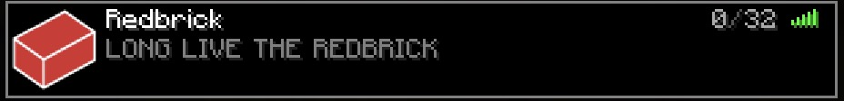
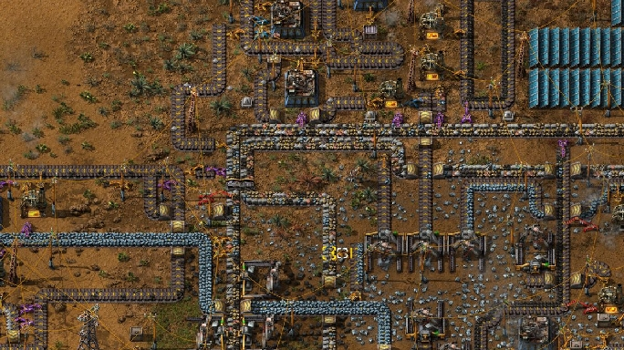
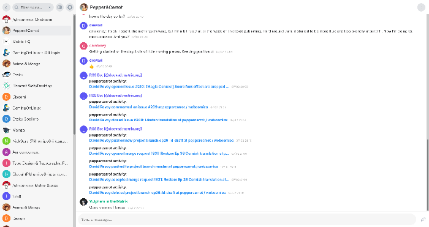
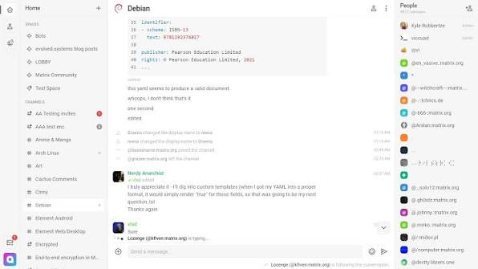
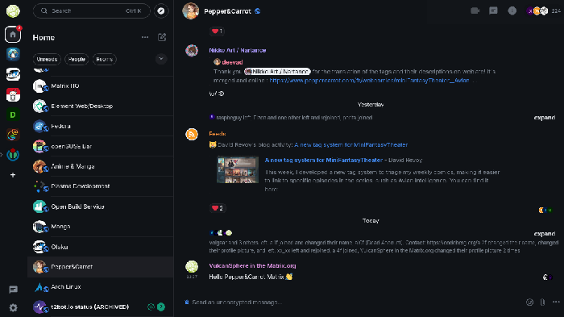
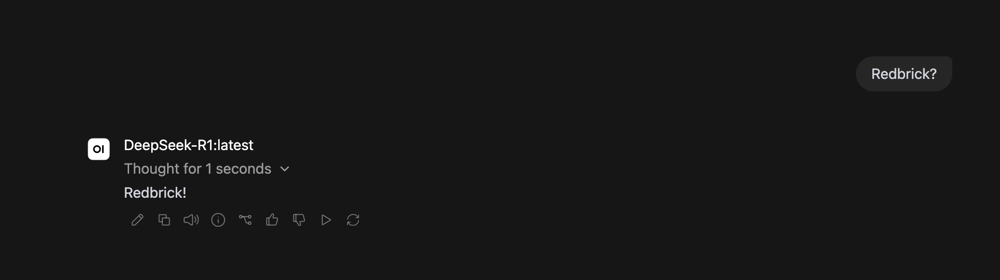
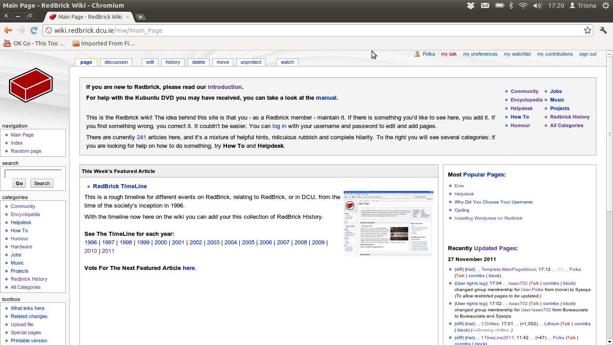
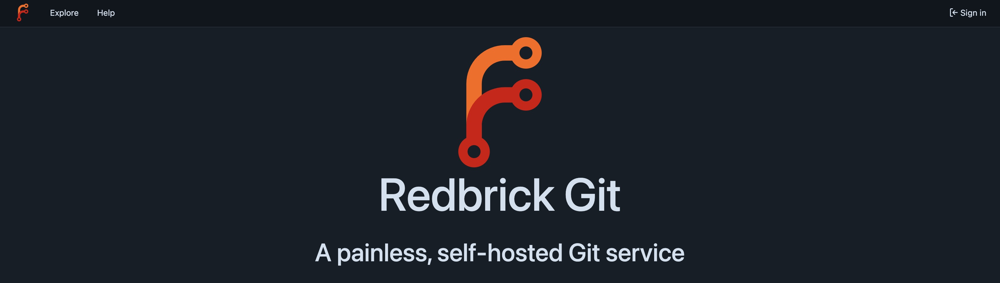

Hello Brickies,

This article will focus on showing you some of the services that Redbrick provides to its members. These services are free to use and are available to all members of the society.

Most services are available to be viewed at [https://redbrick.dcu.ie/services/](https://redbrick.dcu.ie/services/).

But here are a list of them as of the time of writing this article:

### You are a Redbrick Member!!

You were told that you get access to a lot of services. But what are those services?

There are quite a few, but let's start with the basics

## Game servers (The fun stuff)

### Minecraft Server

Available for all Redbrick brickies!

At:vanilla-mc.rb.dcu.ie

(We will be turning on Whitelist soon so make sure to link your minecraft accounts!)

### Palworld

We have it! And you can play it at

**redbrick.dcu.ie** (probably)

i dont have palworld so me cant test oops

### Factorio servers

Soon™ (Semester 2?)

One for Space Age and Vanilla

## And now everything else!

### ✉️. Redbrick Mail
Each Redbrick member gets their own email when they make their Redbrick account

Yours is <username>@redbrick.dcu.ie
The easiest way to access it is through **https://webmail.redbrick.dcu.ie**
Or you can access it with a mail client of your choice (Like Thunderbird)

### Matrix!
Hate Discord? Do you want a more open source way of communicating with your fellow brickies on discord but without actually going there?Use our Discord Matrix!

**hydrogen.redbrick.dcu.ie**

**cinny.redbrick.dcu.ie**

**matrix.redbrick.dcu.ie**

### AI (Beta)

Yes.. AI. But Redbrick AI.Our 100% Air cooled Redbrick AI allows you to use models without worrying about your privacy or paying for them. (and you can get an API key)

Accessible from:
**https://ai.rb.dcu.ie**

We use Ollama and OpenWebUI allowing you to login with your Redbrick account and use it right away!

### Hedgedoc

A nice collaborative space to write your markdown files. You can also use it for basic presentations.

Accessible from: **https://md.redbrick.dcu.ie**

### Redbrick Pastebin
A Redbrick hosted version of PrivateBin

Allows you to share text, long logs, or code.

Accessible at:
**https://paste.redbrick.dcu.ie**

### Redbrick Wiki

The history of Redbrick all in one place

All brickies can contribute to the wiki, so get to work adding your piece!

Accessible at: **https://wiki.redbrick.dcu.ie**

### Git Hosting (With our own Registry!)

We host Forgejo for all our members to use (like a free, open-source version of GitHub).If you host a project on Redbrick, your source code needs to be available to the admins here.Forgejo also has a container registry to store your docker images.

## Now for Login Boxes

We have [Callisto](https://wiki.redbrick.dcu.ie/Callisto) and [Europa](https://wiki.redbrick.dcu.ie/Europa)

### Login Boxes
Are SSH accessible boxes for all brickies in the society. It can be used to work on projects or host your own website using Webtree.Each user has a “public_html” folder. Basically any html code you put there can be publicly viewed at: **https://<username>.redbrick.dcu.ie**

You can also access your files through SCP on the lab machines so you can easily store files you are working on and access them from home. (Useful now that DTS shut down ssh)

:D